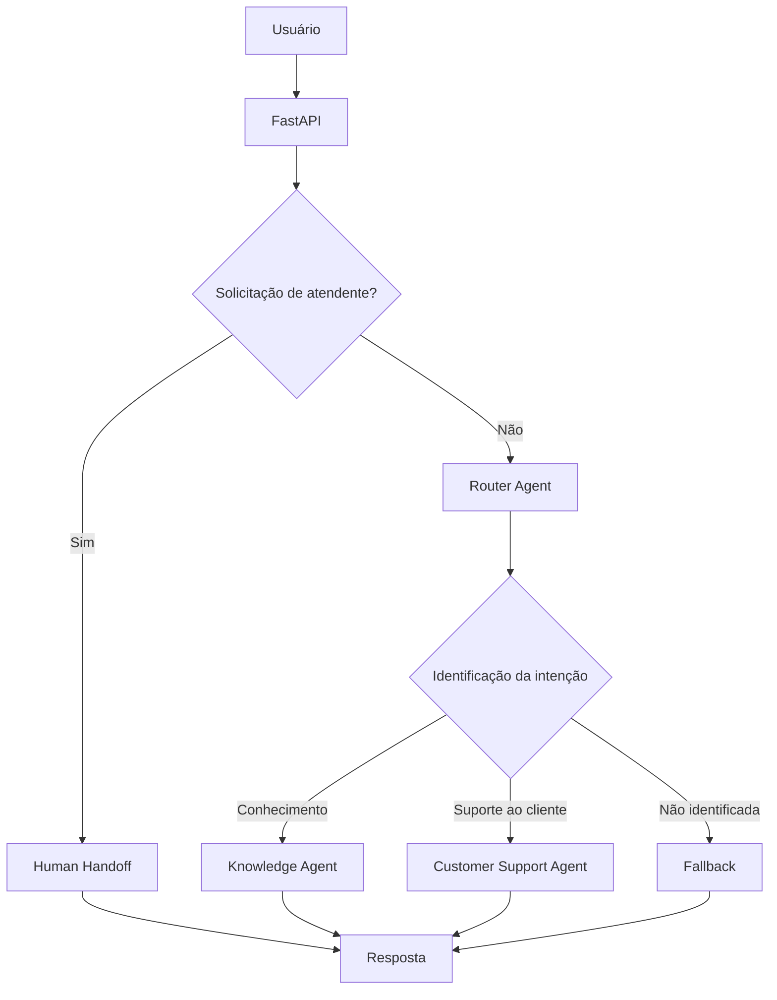

# Getnet Multi-Agent Support System

Sistema de atendimento inteligente desenvolvido como desafio técnico, utilizando arquitetura multiagente para interpretar solicitações, consultar informações da Getnet e recuperar dados de clientes.

## 1. Objetivo

Desenvolver uma API de atendimento que utiliza agentes especializados para identificar a intenção do usuário e direcionar cada solicitação ao componente adequado.

## 2. Arquitetura

O projeto utiliza três agentes principais:

- **Router Agent:** identifica a intenção da mensagem e direciona a solicitação.
- **Knowledge Agent:** responde perguntas sobre produtos, serviços, soluções e funcionalidades da Getnet utilizando RAG e pesquisa na web.
- **Customer Support Agent:** consulta informações de vendas e recebimentos dos clientes por meio de ferramentas Python.

A orquestração dos agentes é realizada pelo LangGraph.

### Fluxo de atendimento



## 3. Tecnologias utilizadas

- Python 3.13
- FastAPI
- LangGraph
- Google Gemini
- Gemini File Search
- Tavily Search API
- SQLite
- SQLAlchemy
- Pydantic
- Docker e Docker Compose
- Pytest

## 4. Funcionalidades

- Classificação automática de intenções.
- Orquestração de agentes especializados.
- Recuperação de conhecimento por RAG utilizando Gemini File Search.
- Pesquisa externa com Tavily.
- Consulta de vendas de clientes.
- Consulta de datas de recebimento.
- Encaminhamento de solicitações para atendimento humano (identificação da intenção; sem integração com uma fila real).
- Validação de entradas e tratamento de erros.
- Persistência de dados em SQLite.
- API REST com documentação Swagger.

## 5. Estrutura do projeto

```text
app/
├── agents/
│   ├── router_agent.py
│   ├── knowledge_agent.py
│   └── customer_support_agent.py
├── api/
│   ├── routes.py
│   └── schemas.py
├── database/
│   ├── connection.py
│   ├── models.py
│   └── seed.py
├── orchestration/
│   ├── graph.py
│   └── state.py
├── prompts/
│   ├── router.txt
│   ├── knowledge.txt
│   └── customer_support.txt
├── rag/
│   ├── ingestion.py
│   └── file_search.py
├── tools/
│   ├── sales.py
│   └── payouts.py
├── config.py
└── main.py

scripts/
└── ingest_knowledge.py

tests/
├── test_database.py
├── test_tools.py
├── test_api.py
├── test_guardrails.py
└── test_integration.py

Dockerfile
docker-compose.yml
.dockerignore
.env.example
requirements.txt
README.md
```

## 6. Configuração do ambiente

### Pré-requisitos

- Python 3.13 ou superior.
- Chave de API do Google Gemini.
- Chave de API do Tavily.
- Docker Desktop (opcional, para execução em contêiner).

### Instalação local

Clone o repositório e acesse a pasta do projeto.

Crie e ative um ambiente virtual:

```powershell
python -m venv .venv
.venv\Scripts\Activate.ps1
```

Instale as dependências:

```powershell
pip install -r requirements.txt
```

Crie o arquivo `.env` a partir do `.env.example`:

```powershell
Copy-Item .env.example .env
```

Configure as seguintes variáveis no arquivo `.env`, utilizando suas próprias chaves:

```env
GEMINI_API_KEY=sua_chave_gemini
GEMINI_MODEL=seu_modelo_gemini
GEMINI_FILE_SEARCH_STORE_NAME=seu_store_name
TAVILY_API_KEY=sua_chave_tavily
```

Não compartilhe ou publique o arquivo `.env`.

## 7. Ingestão da base de conhecimento

Para indexar os documentos utilizados pelo Knowledge Agent no Gemini File Search, execute:

```powershell
python scripts/ingest_knowledge.py
```

A ingestão permite que o agente recupere informações da base de conhecimento antes de recorrer à pesquisa externa.

## 8. Executando a aplicação

### Execução local

```powershell
uvicorn app.main:app --reload
```

A API ficará disponível em:

`http://localhost:8000`

Documentação interativa:

`http://localhost:8000/docs`

### Execução com Docker

Para construir a imagem e iniciar o contêiner:

```powershell
docker compose up --build -d
```

Para verificar o contêiner:

```powershell
docker compose ps
```

Para visualizar os logs:

```powershell
docker compose logs -f api
```

Para interromper a aplicação:

```powershell
docker compose down
```

O banco SQLite utiliza um volume local (`./data`), permitindo preservar os dados mesmo após a recriação do contêiner.

## 9. Endpoints da API

| Método | Endpoint | Descrição |
|---|---|---|
| GET | `/health` | Verifica a saúde da aplicação |
| POST | `/chat` | Envia uma mensagem para o sistema multiagente |

### Exemplo de requisição

Endpoint:

`POST http://localhost:8000/chat`

Corpo da requisição:

```json
{
  "message": "Quais foram minhas vendas?",
  "user_id": "user_001"
}
```

O sistema identifica a intenção, direciona a solicitação ao agente correspondente e retorna a resposta pela API.

## 10. Banco de dados

O projeto utiliza SQLite para armazenar dados de clientes, vendas e recebimentos.

As principais tabelas são:

- Customers
- Sales
- Payouts

O banco é inicializado automaticamente durante a inicialização da aplicação, incluindo os dados de demonstração.

## 11. Testes

Os testes automatizados são executados com Pytest.

Para executar todos os testes:

```powershell
python -m pytest -v
```

Para executar os testes principais:

```powershell
python -m pytest tests/test_database.py tests/test_tools.py tests/test_api.py tests/test_guardrails.py tests/test_integration.py -v
```

Os testes de integração utilizam mocks para validar o fluxo de orquestração sem realizar chamadas externas ao Gemini ou Tavily.

## 12. Segurança e boas práticas

- Chaves de API armazenadas em variáveis de ambiente.
- Arquivo `.env` excluído do versionamento.
- Validação de dados de entrada com Pydantic.
- Tratamento de erros para evitar exposição de informações internas.
- Persistência dos dados utilizando volume Docker.

## 13. Considerações finais

O Getnet Multi-Agent Support System demonstra a aplicação de arquitetura multiagente em um cenário de atendimento, combinando classificação de intenções, recuperação de conhecimento, ferramentas de consulta de dados e exposição de funcionalidades por meio de uma API REST.

O projeto foi desenvolvido com foco em modularidade, organização, testes automatizados e facilidade de execução.