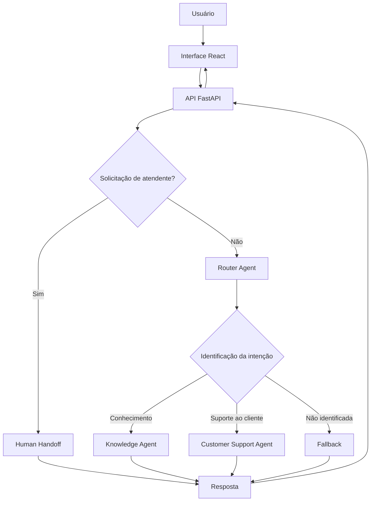

# Getnet Multi-Agent Support System

Sistema inteligente de atendimento desenvolvido como desafio técnico, utilizando arquitetura multiagente para interpretar solicitações, consultar informações da Getnet e recuperar dados de clientes.

A solução combina uma API REST desenvolvida com FastAPI, agentes especializados orquestrados pelo LangGraph, recuperação de conhecimento com RAG e uma interface web desenvolvida em React.

---

## 1. Visão geral

O objetivo do projeto é desenvolver um sistema de atendimento capaz de identificar a intenção de uma solicitação e direcioná-la automaticamente ao agente especializado.

A aplicação disponibiliza:

- Atendimento por meio de uma interface web.
- Classificação automática de intenções.
- Agentes especializados em conhecimento e suporte ao cliente.
- Recuperação de informações utilizando RAG.
- Pesquisa externa na web.
- Consulta de vendas e recebimentos.
- Persistência de dados em SQLite.
- Dashboard para acompanhamento das interações da sessão atual.

## 2. Arquitetura

O sistema utiliza três agentes principais:

- **Router Agent:** identifica a intenção da mensagem e direciona a solicitação ao agente adequado.
- **Knowledge Agent:** responde perguntas sobre produtos, serviços, soluções e funcionalidades da Getnet utilizando RAG e pesquisa externa.
- **Customer Support Agent:** consulta informações de vendas e recebimentos dos clientes por meio de ferramentas Python.

A orquestração dos agentes é realizada pelo LangGraph.

### Fluxo de atendimento



## 3. Tecnologias utilizadas

### Backend

- Python 3.13
- FastAPI
- LangGraph
- Google Gemini
- Gemini File Search
- Tavily Search API
- SQLite
- SQLAlchemy
- Pydantic
- Pytest

### Frontend

- React
- Vite
- Tailwind CSS
- Lucide React

### Infraestrutura

- Docker
- Docker Compose
- Git e GitHub

## 4. Funcionalidades

### Atendimento multiagente

- Classificação automática de intenções.
- Direcionamento inteligente entre agentes especializados.
- Respostas baseadas em conhecimento da Getnet.
- Consulta de informações de clientes.
- Identificação de solicitações de atendimento humano.

### Recuperação de conhecimento

- RAG utilizando Gemini File Search.
- Ingestão de documentos na base de conhecimento.
- Pesquisa externa utilizando Tavily como alternativa de consulta.

### Suporte ao cliente

- Consulta de vendas.
- Consulta de datas de recebimento.
- Utilização de ferramentas Python para recuperação de dados.

### Interface web

- Chat integrado à API FastAPI.
- Sugestões de perguntas para facilitar a utilização.
- Exibição das respostas dos agentes.
- Identificação do agente responsável pela resposta.
- Exibição das ferramentas utilizadas.
- Dashboard com indicadores das interações realizadas na sessão atual.

**Observação:** os indicadores do dashboard representam a sessão atual do navegador e não devem ser interpretados como um histórico consolidado de todas as interações armazenadas no banco de dados.

### Segurança e validação

- Validação de entradas.
- Tratamento de erros.
- Guardrails para proteção do fluxo de atendimento.
- Armazenamento de credenciais em variáveis de ambiente.

O encaminhamento humano identifica a intenção de transferência, mas ainda não está conectado a uma fila real de atendimento.

## 5. Estrutura do projeto

```text
Desafio_IA/
│
├── app/
│   ├── agents/
│   │   ├── router_agent.py
│   │   ├── knowledge_agent.py
│   │   └── customer_support_agent.py
│   │
│   ├── api/
│   │   ├── routes.py
│   │   └── schemas.py
│   │
│   ├── database/
│   │   ├── connection.py
│   │   ├── models.py
│   │   └── seed.py
│   │
│   ├── orchestration/
│   │   ├── graph.py
│   │   └── state.py
│   │
│   ├── prompts/
│   │   ├── router.txt
│   │   ├── knowledge.txt
│   │   └── customer_support.txt
│   │
│   ├── rag/
│   │   ├── ingestion.py
│   │   └── file_search.py
│   │
│   ├── tools/
│   │   ├── sales.py
│   │   └── payouts.py
│   │
│   ├── config.py
│   └── main.py
│
├── frontend/
│   ├── public/
│   ├── src/
│   │   ├── assets/
│   │   ├── App.css
│   │   ├── App.jsx
│   │   ├── index.css
│   │   └── main.jsx
│   ├── package.json
│   └── vite.config.js
│
├── scripts/
│   └── ingest_knowledge.py
│
├── tests/
│   ├── test_database.py
│   ├── test_tools.py
│   ├── test_api.py
│   ├── test_guardrails.py
│   └── test_integration.py
│
├── Dockerfile
├── docker-compose.yml
├── .dockerignore
├── .env.example
├── requirements.txt
└── README.md
```

## 6. Configuração do ambiente

### Pré-requisitos

- Python 3.13 ou superior.
- Node.js e npm.
- Chave de API do Google Gemini.
- Chave de API do Tavily.
- Docker Desktop (opcional).

### 6.1. Clonar o repositório

```powershell
git clone https://github.com/Rabello04/Desafio_IA.git
cd Desafio_IA
```

### 6.2. Configurar o backend

Criar e ativar um ambiente virtual:

```powershell
python -m venv .venv
.venv\Scripts\Activate.ps1
```

Instalar as dependências:

```powershell
pip install -r requirements.txt
```

Criar o arquivo de configuração:

```powershell
Copy-Item .env.example .env
```

Configurar as variáveis no arquivo `.env`, utilizando suas próprias credenciais:

```env
GEMINI_API_KEY=sua_chave_gemini
GEMINI_MODEL=seu_modelo_gemini
GEMINI_FILE_SEARCH_STORE_NAME=seu_store_name
TAVILY_API_KEY=sua_chave_tavily
```

Não compartilhe ou publique o arquivo `.env`.

### 6.3. Configurar o frontend

Em outro terminal, acessar a pasta do frontend:

```powershell
cd frontend
```

Instalar as dependências:

```powershell
npm install
```

## 7. Ingestão da base de conhecimento

Para indexar os documentos utilizados pelo Knowledge Agent no Gemini File Search, execute na raiz do projeto:

```powershell
python scripts/ingest_knowledge.py
```

A ingestão permite que o agente recupere informações da base de conhecimento antes de recorrer à pesquisa externa.

Essa etapa depende da configuração correta das credenciais e do armazenamento do Gemini File Search.

## 8. Executando a aplicação

A aplicação possui dois componentes que devem ser iniciados separadamente na execução local: backend e frontend.

### 8.1. Iniciar o backend

Na raiz do projeto, com o ambiente virtual ativado:

```powershell
python -m uvicorn app.main:app --reload --port 8000
```

A API ficará disponível em:

`http://localhost:8000`

Documentação interativa:

`http://localhost:8000/docs`

### 8.2. Iniciar o frontend

Em outro terminal:

```powershell
cd frontend
npm run dev
```

A interface ficará disponível em:

`http://localhost:5173`

Com os dois serviços ativos, basta acessar a interface pelo navegador.

### 8.3. Execução com Docker

Para construir a imagem e iniciar o contêiner:

```powershell
docker compose up --build -d
```

Verificar o estado dos contêineres:

```powershell
docker compose ps
```

Visualizar os logs:

```powershell
docker compose logs -f api
```

Interromper a aplicação:

```powershell
docker compose down
```

O banco SQLite utiliza um volume local (`./data`), permitindo preservar os dados mesmo após a recriação do contêiner.

A execução do frontend continua sendo realizada separadamente pelo Vite, conforme as instruções anteriores.

## 9. Endpoints da API

| Método | Endpoint | Descrição |
|---|---|---|
| GET | `/health` | Verifica a saúde da aplicação |
| POST | `/chat` | Envia uma mensagem para o sistema multiagente |

### Exemplo de requisição

**Endpoint:**

`POST http://localhost:8000/chat`

**Corpo da requisição:**

```json
{
  "message": "Quais foram minhas vendas?",
  "user_id": "user_001"
}
```

O sistema identifica a intenção, direciona a solicitação ao agente correspondente e retorna a resposta pela API.

A resposta inclui informações como conteúdo da resposta, status, intenção identificada, agente responsável, ferramentas utilizadas, fontes e eventuais erros.

## 10. Banco de dados

O projeto utiliza SQLite para armazenar dados de clientes, vendas e recebimentos.

As principais tabelas são:

- Customers
- Sales
- Payouts

O banco é inicializado automaticamente durante a inicialização da aplicação, incluindo os dados de demonstração.

## 11. Testes

Os testes automatizados são executados com Pytest.

Para executar todos os testes:

```powershell
python -m pytest -v
```

Para executar os testes principais:

```powershell
python -m pytest tests/test_database.py tests/test_tools.py tests/test_api.py tests/test_guardrails.py tests/test_integration.py -v
```

Os testes de integração utilizam mocks para validar o fluxo de orquestração sem realizar chamadas externas ao Gemini ou Tavily.

## 12. Segurança e boas práticas

- Credenciais armazenadas em variáveis de ambiente.
- Arquivo `.env` excluído do versionamento.
- Validação de dados de entrada com Pydantic.
- Tratamento de erros para evitar exposição de informações internas.
- Persistência dos dados utilizando volume Docker.
- Separação entre frontend, API, agentes e camada de dados.
- Testes automatizados para validação dos principais componentes.

## 13. Considerações finais

O Getnet Multi-Agent Support System demonstra a aplicação de arquitetura multiagente em um cenário de atendimento, combinando classificação de intenções, recuperação de conhecimento, ferramentas de consulta de dados e exposição de funcionalidades por meio de uma API REST.

A solução integra tecnologias de inteligência artificial, processamento de dados e desenvolvimento web, com foco em modularidade, organização, validação e facilidade de execução.

---

**Repositório:** https://github.com/Rabello04/Desafio_IA