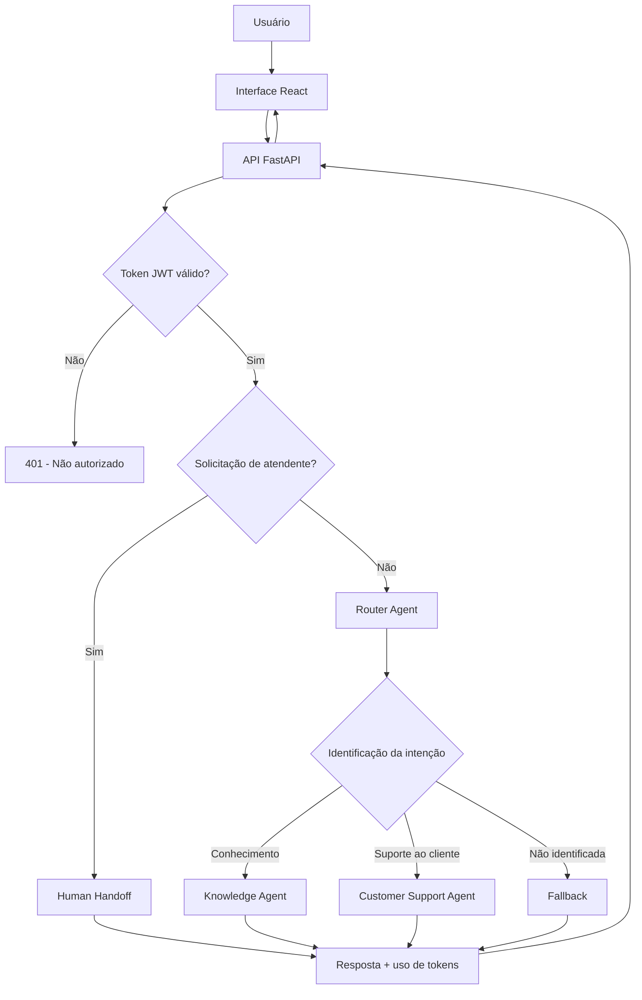

# Getnet Multi-Agent Support System

Sistema inteligente de atendimento desenvolvido como desafio técnico, utilizando arquitetura multiagente para interpretar solicitações, consultar informações da Getnet e recuperar dados de clientes.

A solução combina uma API REST desenvolvida com FastAPI, autenticação com JWT, agentes especializados orquestrados pelo LangGraph, recuperação de conhecimento com RAG, consulta de dados de clientes e uma interface web desenvolvida em React.

---

## 1. Visão geral

O objetivo do projeto é desenvolver um sistema de atendimento capaz de identificar a intenção de uma solicitação e direcioná-la automaticamente ao agente especializado.

A aplicação disponibiliza:

- Atendimento por meio de uma interface web.
- Classificação automática de intenções.
- Agentes especializados em conhecimento e suporte ao cliente.
- Recuperação de informações utilizando RAG.
- Pesquisa externa na web.
- Consulta de vendas e recebimentos.
- Persistência de dados em SQLite.
- Dashboard para acompanhamento das interações da sessão atual.
- Autenticação de usuários com JWT e senhas protegidas com Argon2.
- Proteção do endpoint de chat por token de acesso.
- Monitoramento do consumo real de tokens informado pela API do Gemini, por interação e acumulado na sessão do navegador.

## 2. Arquitetura

O sistema utiliza três agentes principais:

- **Router Agent:** identifica a intenção da mensagem e direciona a solicitação ao agente adequado.
- **Knowledge Agent:** responde perguntas sobre produtos, serviços, soluções e funcionalidades da Getnet utilizando RAG e pesquisa externa.
- **Customer Support Agent:** consulta informações de vendas e recebimentos dos clientes por meio de ferramentas Python.
- **Human Handoff:** identifica solicitações de atendimento humano e retorna o estado de encaminhamento. Nesta versão, o fluxo é demonstrativo e não está conectado a uma fila real.

A orquestração dos agentes é realizada pelo LangGraph. O acesso à API é protegido por autenticação JWT.

### Fluxo de atendimento



## 3. Tecnologias utilizadas

### Backend

- Python 3.13
- FastAPI
- LangGraph
- Google Gemini
- Gemini File Search
- Tavily Search API
- SQLite
- SQLAlchemy
- Pydantic
- PyJWT
- pwdlib com Argon2
- Pytest

### Frontend

- React
- Vite
- Tailwind CSS
- Lucide React

### Infraestrutura

- Docker
- Docker Compose
- Git e GitHub

## 4. Funcionalidades

### Atendimento multiagente

- Classificação automática de intenções.
- Direcionamento inteligente entre agentes especializados.
- Respostas baseadas em conhecimento da Getnet.
- Consulta de informações de clientes.
- Identificação de solicitações de atendimento humano.

### Recuperação de conhecimento

- RAG utilizando Gemini File Search.
- Ingestão de documentos na base de conhecimento.
- Pesquisa externa utilizando Tavily como alternativa de consulta.

### Suporte ao cliente

- Consulta de vendas.
- Consulta de datas de recebimento.
- Utilização de ferramentas Python para recuperação de dados.

### Interface web

- Chat integrado à API FastAPI.
- Sugestões de perguntas para facilitar a utilização.
- Exibição das respostas dos agentes.
- Identificação do agente responsável pela resposta.
- Exibição das ferramentas utilizadas.
- Dashboard com indicadores das interações realizadas na sessão atual.
- Indicadores de tokens de entrada, saída e total, com valores retornados pelos metadados de uso do Gemini.
- Acumulação do consumo de tokens por interação durante a sessão atual do navegador.

**Observações:**
- Os indicadores do dashboard representam a sessão atual do navegador e não devem ser interpretados como um histórico consolidado de todas as interações armazenadas no banco de dados.
- O contador utiliza os metadados de uso retornados nas chamadas ao Gemini. A leitura desses metadados não exige uma chamada adicional ao modelo e, portanto, não gera consumo extra de tokens.
- O contador não representa tokens utilizados por serviços externos, como Tavily, nem necessariamente o consumo de outros provedores.

### Segurança e validação

- Login com usuário e senha.
- Senhas armazenadas com hash Argon2.
- Geração e validação de tokens JWT.
- Proteção do endpoint `/chat`, que exige um token válido.
- Validação de entradas com Pydantic.
- Tratamento de erros.
- Guardrails para proteção do fluxo de atendimento.
- Armazenamento de segredos e credenciais em variáveis de ambiente.

O encaminhamento humano identifica a intenção de transferência, mas ainda não está conectado a uma fila real de atendimento.

## 5. Estrutura do projeto

```text
Desafio_IA/
│
├── app/
│   ├── agents/
│   │   ├── router_agent.py
│   │   ├── knowledge_agent.py
│   │   └── customer_support_agent.py
│   │
│   ├── api/
│   │   ├── auth.py
│   │   ├── routes.py
│   │   └── schemas.py
│   │
│   ├── database/
│   │   ├── connection.py
│   │   ├── models.py
│   │   └── seed.py
│   │
│   ├── orchestration/
│   │   ├── graph.py
│   │   └── state.py
│   │
│   ├── prompts/
│   │   ├── router.txt
│   │   ├── knowledge.txt
│   │   └── customer_support.txt
│   │
│   ├── rag/
│   │   ├── ingestion.py
│   │   └── file_search.py
│   │
│   ├── tools/
│   │   ├── sales.py
│   │   └── payouts.py
│   │
│   ├── config.py
│   └── main.py
│
├── frontend/
│   ├── public/
│   ├── src/
│   │   ├── assets/
│   │   ├── App.css
│   │   ├── App.jsx
│   │   ├── index.css
│   │   └── main.jsx
│   ├── package.json
│   └── vite.config.js
│
├── scripts/
│   └── ingest_knowledge.py
│
├── tests/
│   ├── test_database.py
│   ├── test_tools.py
│   ├── test_api.py
│   ├── test_guardrails.py
│   └── test_integration.py
│
├── Dockerfile
├── docker-compose.yml
├── .dockerignore
├── .env.example
├── requirements.txt
└── README.md
```

## 6. Configuração do ambiente

### Pré-requisitos

- Python 3.13 ou superior.
- Node.js e npm.
- Chave de API do Google Gemini.
- Chave de API do Tavily.
- Docker Desktop (opcional).

### 6.1. Clonar o repositório

```powershell
git clone https://github.com/Rabello04/Desafio_IA.git
cd Desafio_IA
```

### 6.2. Configurar o backend

Criar e ativar um ambiente virtual:

```powershell
python -m venv .venv
.venv\Scripts\Activate.ps1
```

Instalar as dependências:

```powershell
pip install -r requirements.txt
```

Criar o arquivo de configuração:

```powershell
Copy-Item .env.example .env
```

Configurar as variáveis no arquivo `.env`, utilizando suas próprias credenciais:

```env
GEMINI_API_KEY=sua_chave_gemini
GEMINI_MODEL=seu_modelo_gemini
GEMINI_FILE_SEARCH_STORE_NAME=seu_store_name
TAVILY_API_KEY=sua_chave_tavily

JWT_SECRET_KEY=gere_uma_chave_forte_e_aleatoria
JWT_ALGORITHM=HS256
ACCESS_TOKEN_EXPIRE_MINUTES=60
```

Não compartilhe ou publique o arquivo `.env`.

### 6.3. Configurar o frontend

Em outro terminal, acessar a pasta do frontend:

```powershell
cd frontend
```

Instalar as dependências:

```powershell
npm install
```

## 7. Pipeline RAG — ingestão, armazenamento, recuperação e geração

O Knowledge Agent utiliza Retrieval-Augmented Generation (RAG) para responder perguntas sobre produtos, serviços e soluções da Getnet com apoio de conteúdo obtido em páginas oficiais. O pipeline está dividido em quatro etapas.

### 7.1. Ingestão das fontes

As fontes são definidas em `scripts/ingest_knowledge.py`. Atualmente, o projeto utiliza oito páginas:

- [Todas as maquininhas](https://site.getnet.com.br/todas-as-maquininhas/)
- [Get Lite](https://site.getnet.com.br/get-lite/)
- [Get Clássica](https://site.getnet.com.br/maquininha/get-classica/)
- [Get Smart](https://site.getnet.com.br/maquininha/get-smart/)
- [Taxas](https://site.getnet.com.br/taxas/)
- [Get Tap](https://site.getnet.com.br/get-tap/)
- [Get Ajuda](https://site.getnet.com.br/get-ajuda/)
- [Getnet — site institucional global](https://www.getnet.net/en/)

O componente `KnowledgeIngestion`, em `app/rag/ingestion.py`, acessa cada URL com `requests` e processa o HTML com BeautifulSoup. Elementos que não fazem parte do conteúdo principal, como scripts, estilos, navegação, cabeçalho, rodapé e SVGs, são removidos. Em seguida, o extrator prioriza o conteúdo das tags `main` ou `article`, utilizando o corpo da página como alternativa.

### 7.2. Preparação e armazenamento

O texto extraído é salvo localmente em `data/knowledge_sources/`, em arquivos `.txt` que incluem a URL de origem e o conteúdo textual. O nome dos arquivos utiliza hashes derivados da URL e do conteúdo.

Cada fonte também recebe metadados, como:

- URL de origem (`source_url`).
- Público-alvo (`audience`).
- Categoria do conteúdo (`category`).
- Tipo da fonte (`source_type`).
- País ou abrangência (`country`).

Depois da preparação, os arquivos são enviados ao Gemini File Search. O serviço utiliza o `GEMINI_FILE_SEARCH_STORE_NAME` configurado no ambiente. Caso o nome do armazenamento não esteja configurado, o código cria um File Search Store chamado `Getnet Knowledge Base` e informa o identificador que deve ser adicionado ao `.env`.

O Gemini File Search é responsável pelo processamento e pela indexação dos documentos no armazenamento. O projeto não implementa manualmente uma base vetorial ou uma rotina própria de divisão em chunks. Durante o envio, a aplicação acompanha a operação até a conclusão e sinaliza eventuais erros de indexação.

### 7.3. Recuperação de informações

Quando recebe uma pergunta relacionada ao conhecimento da Getnet, o Knowledge Agent utiliza o Gemini File Search para localizar conteúdo relevante no armazenamento previamente indexado. Assim, a resposta pode ser baseada nas informações recuperadas das fontes, em vez de depender exclusivamente do conhecimento geral do modelo.

A recuperação depende de o armazenamento estar configurado e de os documentos terem sido ingeridos e indexados anteriormente.

### 7.4. Geração da resposta

Com o contexto recuperado, o Knowledge Agent utiliza o modelo Gemini para formular uma resposta em linguagem natural. O objetivo é responder à solicitação com base nas informações disponíveis na base de conhecimento.

O projeto também disponibiliza a pesquisa externa por meio da Tavily Search API para perguntas gerais que necessitam de consulta à web. Essa pesquisa é uma ferramenta complementar do agente e não deve ser confundida com a ingestão das páginas da Getnet no armazenamento RAG.

### 7.5. Executar a ingestão

Com as credenciais do Gemini configuradas no `.env`, execute na raiz do projeto:

```powershell
python scripts/ingest_knowledge.py
```

O script percorre as URLs configuradas, extrai o conteúdo, prepara os arquivos e os envia ao Gemini File Search. Ao final, apresenta um resumo com a quantidade de fontes processadas e as que apresentaram erro.

As variáveis relacionadas ao Gemini são:

```env
GEMINI_API_KEY=sua_chave_gemini
GEMINI_MODEL=seu_modelo_gemini
GEMINI_FILE_SEARCH_STORE_NAME=seu_store_name
```

A primeira execução pode criar o File Search Store quando `GEMINI_FILE_SEARCH_STORE_NAME` estiver vazio. Nesse caso, copie o identificador apresentado no terminal para o `.env` e mantenha-o nas próximas execuções para reutilizar o mesmo armazenamento.

Execute novamente a ingestão quando quiser atualizar o conteúdo indexado a partir das páginas configuradas. A disponibilidade das fontes depende dos respectivos sites e das credenciais dos serviços externos.

## 8. Executando a aplicação

A aplicação possui dois componentes que devem ser iniciados separadamente na execução local: backend e frontend.

### 8.1. Iniciar o backend

Na raiz do projeto, com o ambiente virtual ativado:

```powershell
python -m uvicorn app.main:app --reload --port 8000
```

A API ficará disponível em:

`http://localhost:8000`

Documentação interativa:

`http://localhost:8000/docs`

### 8.2. Iniciar o frontend

Em outro terminal:

```powershell
cd frontend
npm run dev
```

A interface ficará disponível em:

`http://localhost:5173`

Com os dois serviços ativos, basta acessar a interface pelo navegador.

### 8.3. Execução com Docker

Para construir a imagem e iniciar o contêiner:

```powershell
docker compose up --build -d
```

Verificar o estado dos contêineres:

```powershell
docker compose ps
```

Visualizar os logs:

```powershell
docker compose logs -f api
```

Interromper a aplicação:

```powershell
docker compose down
```

O banco SQLite utiliza um volume local (`./data`), permitindo preservar os dados mesmo após a recriação do contêiner.

A execução do frontend continua sendo realizada separadamente pelo Vite, conforme as instruções anteriores.

## 9. Endpoints da API

| Método | Endpoint | Autenticação | Descrição |
|---|---|---|---|
| GET | `/health` | Não | Verifica a saúde da aplicação |
| POST | `/auth/login` | Não | Valida as credenciais e retorna um JWT |
| POST | `/chat` | Bearer Token | Envia uma mensagem para o sistema multiagente |

### Autenticação

Antes de utilizar o chat, o cliente deve autenticar-se por meio do endpoint `/auth/login`.

**Requisição:**

`POST http://localhost:8000/auth/login`

```json
{
  "username": "user_001",
  "password": "Getnet@2026-001"
}
```

A resposta contém um token de acesso. O frontend armazena esse token durante a sessão e o envia no cabeçalho `Authorization` das requisições protegidas.

**Exemplo de cabeçalho:**

```http
Authorization: Bearer SEU_TOKEN_JWT
```

### Usuários de demonstração

O banco de dados é inicializado com cinco usuários de demonstração:

| Usuário | Senha |
|---|---|
| `user_001` | `Getnet@2026-001` |
| `user_002` | `Getnet@2026-002` |
| `user_003` | `Getnet@2026-003` |
| `user_004` | `Getnet@2026-004` |
| `user_005` | `Getnet@2026-005` |

Essas credenciais são destinadas exclusivamente ao ambiente demonstrativo. Não utilize senhas de demonstração em produção.

### Envio de mensagem ao chat

**Endpoint:**

`POST http://localhost:8000/chat`

**Cabeçalho:**

```http
Authorization: Bearer SEU_TOKEN_JWT
Content-Type: application/json
```

**Corpo da requisição:**

```json
{
  "message": "Quais foram minhas vendas?"
}
```

O identificador do cliente é obtido a partir do usuário autenticado no token. Não é necessário nem permitido enviar `user_id` no corpo da requisição.

O sistema identifica a intenção, direciona a solicitação ao agente correspondente e retorna a resposta pela API. A resposta inclui informações como conteúdo, status, intenção identificada, agente responsável, ferramentas utilizadas, fontes, eventuais erros e metadados de consumo de tokens do Gemini.

Requisições ao endpoint `/chat` sem token ou com token inválido retornam `401 Unauthorized`.

## 10. Banco de dados

O projeto utiliza SQLite para armazenar dados de clientes, vendas e recebimentos.

As principais tabelas são:

- Customers
- Customer Credentials
- Sales
- Payouts

As credenciais dos usuários são armazenadas separadamente dos dados cadastrais, com senhas protegidas por hash Argon2. O banco é inicializado automaticamente durante a inicialização da aplicação, incluindo os dados de demonstração.

## 11. Testes

Os testes automatizados são executados com Pytest.

Para executar todos os testes:

```powershell
python -m pytest -v
```

Para executar os testes principais:

```powershell
python -m pytest tests/test_database.py tests/test_tools.py tests/test_api.py tests/test_guardrails.py tests/test_integration.py -v
```

Os testes de integração utilizam mocks para validar o fluxo de orquestração sem realizar chamadas externas ao Gemini ou Tavily.

## 12. Segurança e boas práticas

- Segredos e credenciais de serviços externos armazenados em variáveis de ambiente.
- Arquivo `.env` excluído do versionamento.
- Senhas de usuários protegidas com Argon2.
- Autenticação baseada em JWT e expiração configurável do token.
- Endpoint `/chat` protegido por autenticação.
- Validação de dados de entrada com Pydantic.
- Tratamento de erros para evitar exposição de informações internas.
- Persistência dos dados utilizando volume Docker.
- Separação entre frontend, API, agentes e camada de dados.
- Testes automatizados para validação dos principais componentes.

## 13. Avaliação, observabilidade e monitoramento

A qualidade do sistema multiagente deve ser acompanhada por meio de testes automatizados, avaliações periódicas das respostas e monitoramento do comportamento dos agentes.

### Critérios de avaliação

Os principais critérios considerados para avaliar o sistema são:

- **Precisão do roteamento:** verificar se o Router Agent direciona cada solicitação ao agente adequado.
- **Relevância das respostas:** avaliar se as respostas atendem à intenção e à necessidade apresentada pelo usuário.
- **Fidelidade ao contexto RAG:** verificar se as respostas sobre produtos e serviços da Getnet estão fundamentadas nas informações recuperadas.
- **Uso correto de ferramentas:** validar se as ferramentas de consulta de vendas e recebimentos são acionadas quando necessário e retornam informações coerentes.
- **Tratamento de falhas:** observar o comportamento do sistema diante de erros, ausência de dados ou indisponibilidade de serviços externos.
- **Encaminhamento humano:** verificar se solicitações de atendimento humano são identificadas corretamente.

### Estratégia de testes e avaliação

Além dos testes automatizados implementados com Pytest, recomenda-se manter um conjunto de perguntas representativas para avaliar periodicamente o comportamento do sistema.

Esse conjunto pode incluir perguntas sobre produtos e serviços Getnet, vendas e recebimentos, dúvidas gerais que exijam pesquisa externa, solicitações ambíguas e pedidos de atendimento humano.

Os resultados podem ser comparados ao longo das alterações no projeto, permitindo identificar regressões no roteamento, na recuperação de informações e na execução das ferramentas.

### Observabilidade em produção

Em um ambiente de produção, recomenda-se utilizar logs estruturados para acompanhar cada interação. Entre os dados úteis para diagnóstico estão:

- Identificador da requisição.
- Identificador do usuário, respeitando os cuidados de privacidade.
- Intenção identificada e agente acionado.
- Ferramentas executadas e seus respectivos resultados.
- Tempo de resposta da requisição e dos serviços externos.
- Status da execução, erros e ocorrências de fallback.
- Identificação de solicitações de encaminhamento humano.

### Indicadores de monitoramento

A partir desses registros, podem ser acompanhados indicadores como volume de interações, distribuição de intenções, frequência de acionamento de cada agente, taxa de sucesso das ferramentas, latência, quantidade de erros, ocorrências de fallback e solicitações de atendimento humano.

A aplicação também apresenta, no dashboard do frontend, o consumo de tokens de entrada, saída e total informado pelo Gemini. Os valores são agregados no estado da sessão atual do navegador; não constituem um relatório histórico persistido no banco de dados.

Também é recomendável acompanhar a disponibilidade da API e dos serviços externos utilizados, além de configurar alertas para falhas recorrentes ou aumento anormal do tempo de resposta.

### Escopo atual e evolução

O projeto já conta com testes automatizados, validações, guardrails e tratamento de erros para os principais fluxos. Entretanto, a instrumentação completa de métricas, traces distribuídos, alertas e dashboards operacionais não faz parte da implementação atual.

Os critérios, indicadores e práticas descritos nesta seção representam uma estratégia de avaliação e observabilidade para orientar a evolução e a operação do sistema em um ambiente real.

## 14. Consumo de tokens

O backend coleta os metadados de utilização disponibilizados nas respostas da API do Gemini e consolida os valores associados às etapas do fluxo multiagente, incluindo o roteamento e as chamadas dos agentes.

O retorno do endpoint `/chat` pode incluir o objeto `token_usage`, com os totais de tokens de entrada, saída e consumo total da interação. O frontend utiliza esses dados para atualizar os indicadores do dashboard e apresentar o consumo por mensagem.

**Pontos importantes:**
- Os números são baseados nos metadados de uso fornecidos pelo Gemini, e não em estimativas feitas pelo frontend.
- A leitura dos metadados não realiza uma chamada adicional ao modelo.
- Chamadas a serviços externos, como Tavily Search, não entram na contagem de tokens do Gemini.
- Os totais exibidos no dashboard são acumulados na sessão atual do navegador e não são persistidos como histórico de consumo no SQLite.
- Se uma resposta não disponibilizar metadados de uso, os valores correspondentes podem aparecer como zero.

## 15. Considerações finais

O Getnet Multi-Agent Support System demonstra a aplicação de arquitetura multiagente em um cenário de atendimento, combinando classificação de intenções, recuperação de conhecimento, ferramentas de consulta de dados e exposição de funcionalidades por meio de uma API REST.

A solução integra tecnologias de inteligência artificial, processamento de dados e desenvolvimento web, com foco em modularidade, organização, validação e facilidade de execução.

---

**Repositório:** https://github.com/Rabello04/Desafio_IA